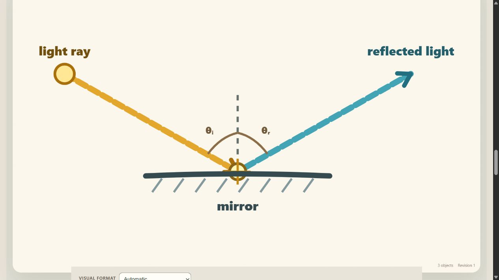
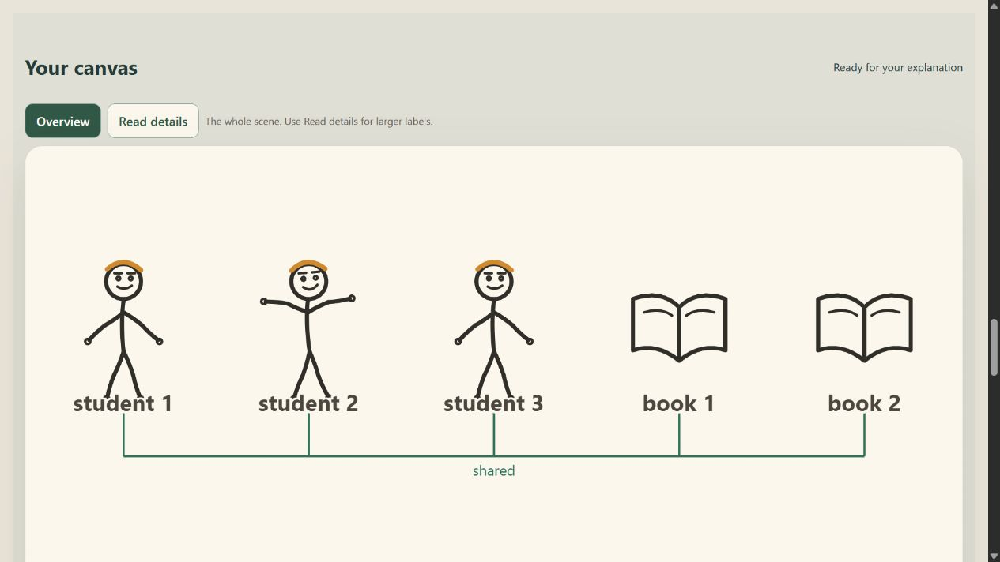
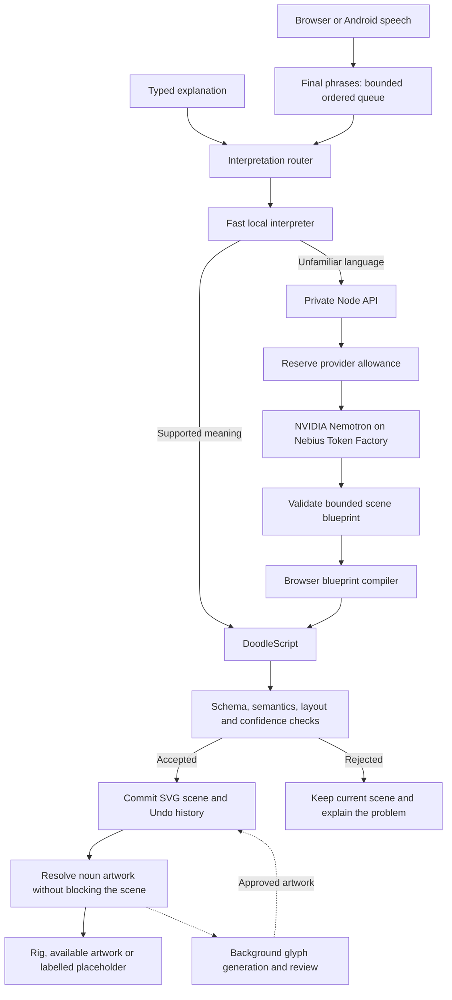

# Geera

### Give your words shape.

**What if the explanation in your head could become something others can see, as you speak?** No slides prepared beforehand. No drawing skills required. Just your understanding and your words.

Geera is an early-stage speech-and-text visualization app working toward that vision. This version turns supported explanations into SVG drawings, diagrams, and mixed visual/text explanations, with NVIDIA Nemotron through Nebius handling unfamiliar language.

[](https://geera-y7hb.onrender.com/)
[](#what-works-today)
[](LICENSE)
[](#how-it-works)

**[Open the app](https://geera-y7hb.onrender.com/) · [Try an explanation](#try-it) · [Architecture](#how-it-works) · [Evidence and failures](#what-testing-has-taught-us) · [Run locally](#run-locally)**



*Captured from the running application. This is a supported reflection example, not a generated marketing mockup or a claim that every explanation works.*

## A classroom started this

My O-level Biology teacher struggled to write on the chalkboard. I watched the effort it took to turn what he understood into something we could understand too.

Later, struggling to explain my own ideas during presentations, I kept returning to that classroom. What if the act of explaining could build the visual alongside the words?

That became Geera. Its name comes from the Luganda **tegeera**, meaning **to understand**. Earlier source files and development records retain the name Tegeera.

The ambition reaches from nursery and primary classrooms to secondary school, university, presentations, and everyday explanations. A teacher or student should be able to use the device they already have, including a simple phone. Accessibility, broader language support, and reliable real-time drawing are goals we are building toward; this first version does not yet fulfil all of them.

## Try it

**[Watch the story and demo](https://www.youtube.com/watch?v=R_VkPubjWnQ)** · **[Fresh judge walkthrough and live results](docs/JUDGE_TESTING_2026-10-29.md)**

The walkthrough records five accepted relationship scenes and two rejected explanations from one fresh deployed-app session, including unfinished artwork. It is not a universal accuracy claim or a physical-phone speech verification.

1. Open **[geera-y7hb.onrender.com](https://geera-y7hb.onrender.com/)** and choose **Open canvas**. Render's free instance can take roughly a minute to wake after inactivity.
2. Type **`Three students share two books`**. Inspect the objects and the shared relationship.
3. Expand **Explore examples by subject → Science** and choose **`A light ray travels toward a mirror and reflects off it.`**
4. Try your own wording. Inspect the meaning and arrows, not only whether something appeared. Use **Undo** to return to the previous scene.
5. For speech, open the HTTPS site in a browser that supports speech recognition, tap **Speak**, allow the microphone, and speak with brief pauses between sentences. **Stop** ends listening. Browser/device support varies; typing remains available.

New AI interpretations can take seconds and use a limited shared allowance. If the service is waking, unavailable, or out of allowance, supported local drawing remains available after the page loads. Do not submit private or sensitive information: explanations may be sent to the model provider, and browser speech may use the browser's speech service.



## What works today

| Area | Implemented in this version | Current boundary |
| --- | --- | --- |
| Drawings and diagrams | Counts, colors, sharing, queues, movement, and supported science/computing visual families | Coverage is uneven; an accepted plan can still omit meaning or have weak artwork |
| Broader language | Hosted Nemotron produces structured scene plans for the browser compiler | A network request and sometimes a repair are needed; accuracy is not universal |
| Abstract and mixed explanations | Source-text maps can combine locally supported illustrations with preserved statements and questions | Text relationships are not fact-checks; some drawable clauses still remain text |
| Continuous speech | Recognized final phrases enter an ordered queue while capture continues; interim words can show provisional hints | Not word-by-word finished drawing; provider delays can create a backlog, and phone reliability needs more testing |
| Noun artwork | Procedural figures, licensed provisional sketches, exact-name previews, cached approved art, and generated drafts | Unfamiliar nouns may stay labelled placeholders; recognizability requires review |
| Access | Browser app, keyboard controls, SVG accessibility descriptions, larger-label detail view, reduced motion | Broader accessibility and classroom testing remain open |

The browser and Capacitor Android project share the drawing engine. The current public entry point is the web app. This repository does not claim a newly verified APK release.

## How it works

**The model interprets; the application checks, lays out, and renders.** Scene geometry is produced by code rather than accepted as unrestricted model-generated markup.



The server also validates provider output and bounds repair attempts. Validation catches specified failure classes; it cannot establish complete semantic truth or visual quality.

### Engineering decisions worth inspecting

| Decision | Why it matters | Implementation |
| --- | --- | --- |
| A constrained visual language | Separates meaning from rendering and makes scene changes testable | [DoodleScript validator](src/doodlescript/validator.ts), [blueprint compiler](src/llm/universalScene.ts) |
| Ordered speech with backpressure | New speech does not cancel earlier work; a bounded queue prevents unlimited backlog | [SpeechWorkQueue](src/speech/SpeechWorkQueue.ts), [session lifecycle](src/speech/SpeechSession.ts) |
| Synchronous artwork lookup, asynchronous generation | A slow noun request does not block the accepted semantic scene | [LiveGlyphResolver](src/glyphs/runtimeResolver.ts), [stroke language](src/glyphs/strokeGlyph.ts) |
| Revalidate cached plans | Exact repeats in the same context can avoid another model call without bypassing validation | [Accepted-plan cache](src/llm/acceptedPlanCache.ts) |
| Durable usage reservations | Render restarts must not reset the shared provider allowance | [Atomic Redis budget](server/remoteBudget.mjs), [deployment gates](server/deploymentSafety.mjs) |
| One web origin | The site and `/api` run in one Node service; shared provider keys stay server-side | [Web server](server/web.mjs), [Render blueprint](render.yaml) |

The local interpreter has explicit rules and reusable visual grammars. It is not a universal language model. The hosted path fills open entity and relationship slots; it does not retrieve a finished picture for each benchmark sentence. Evaluation expectations live separately from the production grammar. That separation supports generalization, but does not prove it. See the [evaluation methodology](evaluation/README.md).

## Trade-offs we chose deliberately

Geera focuses on one task: making an explanation visible. The current architecture balances that task against limited inference credits, ordinary devices, and the risk of drawing the wrong relationship.

| Choice | What it buys | What it costs, and the next step |
| --- | --- | --- |
| Local visual grammars plus hosted Nemotron 3 Super | Supported explanations render without a model request; unfamiliar language gets broader reasoning | Local coverage is bounded and hosted calls take seconds. Measure routing and repair rates on unseen explanations before changing the model. |
| Schema-constrained plans and bounded repair | Inspectable entities and relationships, with opportunities to catch malformed or incomplete output | Valid JSON can still miss meaning, and repairs add latency and tokens. Evaluate semantic correctness separately from structure. |
| Keep tested reasoning settings | Protects completeness on the small difficult-graph probes we recorded | Faster modes sometimes lost important relationships. A smaller/faster model needs its own quality evaluation; it is not an automatic upgrade. |
| Procedural figures, retrieved sketches, and labelled placeholders | Available artwork can appear without waiting for fresh generation | Style and recognizability vary. Build a reviewed, consistent doodle vocabulary and improve unfamiliar-object generation in the background. A placeholder is not a finished illustration. |
| Final recognized phrases processed in order | Preserves speech order and supports Undo while listening continues | This is not word-by-word finished drawing. Incremental scene updates need stronger context handling and real-phone latency measurements. |
| Hosted inference and lightweight browser SVG | Users do not need to run the language model on their own device | Unfamiliar explanations need connectivity. Broad low-end-device, accessibility, and classroom performance remain to be tested. |
| Free Render hosting and bounded provider usage | Makes a publicly accessible early version affordable | Idle services can take about a minute to wake, and shared inference allowance is finite. The brand animation is optional; use **Open canvas** for the product. |

The [inference investigation](docs/REALTIME_INFERENCE.md) records the actual model/mode experiments and their limitations. We used Nebius Token Factory's hosted API, not self-managed GPU instances or a claimed autoscaling deployment. The roadmap is to reduce waiting while improving meaning and artwork together, rather than counting a faster but less accurate drawing as progress.

## What testing has taught us

### Speech portability and presentation cost

Speech recognition is supplied by the browser or Android service, not by Nemotron. Chrome's continuous recognition path remains separate from drawing inference. Browsers without that service, including Opera configurations, offer device keyboard dictation into the same explanation field followed by **Draw it**. This fallback does not provide continuous in-app listening. A cross-browser transcription service is a remaining integration, with additional audio privacy, latency and inference-cost considerations.

The brand film is separate from inference. Its existing media files are preserved: the phone loader prioritizes frames near the current scroll position, rendering updates avoid a React update for every scroll position, and the web server supplies cache validators plus a one-hour media cache. These changes reduce repeat transfers and unnecessary work; they cannot remove Render's cold start or make the first download instantaneous.

**A passing validator is not the same thing as a correct explanation. A fast response is not the same thing as a good drawing.**

| Finding | Engineering response | Evidence and remaining gap |
| --- | --- | --- |
| A model could return valid JSON while losing important relationships | Added source-grounding checks and bounded repair feedback | [Inference investigation](docs/REALTIME_INFERENCE.md); some valid plans still miss meaning |
| Generated noun strokes passed the schema but looked unrecognizable | Separated artwork review from structural validation; retained honest fallbacks and licensed retrieval | [Glyph quality experiments](docs/GLYPH_QUALITY_STATUS.md); long-tail artwork remains a major gap |
| Faster reasoning modes traded correctness for speed in small probes | Kept model settings evidence-driven rather than promoting the fastest response | [Timing and quality comparisons](docs/REALTIME_INFERENCE.md); not a general speed benchmark |
| Late speech callbacks and cancellation could interfere with a newer session | Added session-generation checks, bounded restarts, and regression tests | [23 October reliability report](docs/RELIABILITY_2026-10-23.md) |
| A roof → gutter → barrel explanation repeatedly produced inconsistent propagation | Recorded the rejection and preserved the scene instead of counting it as success | [Live failure record](docs/RELIABILITY_2026-10-23.md); still unresolved in that checkpoint |

### Evidence, with scope attached

- **26 October:** 89 backend tests passed again during this README update. These use controlled tests; they do not measure live-provider accuracy.
- **26 October:** 44 focused client regressions passed during the mobile/speech patch, alongside TypeScript, lint, production bundling, and bundle-budget checks. Phone-sized browser screenshots were inspected; physical-phone microphone behavior remains unverified.
- **23 October historical checkpoint:** 807 client tests passed, with three optional live-provider tests skipped. This is a dated full-run record, not today's asserted total.
- **9 October local-only baseline:** 25 of 60 independent teacher statements produced validator-safe drawings. This measures local coverage, not visual correctness or hosted AI coverage.

No overall completion percentage or universal accuracy claim is inferred from these numbers. Small live probes have taken seconds, with repairs sometimes extending them to tens of seconds. The real-time vision remains ahead of the current implementation.

**[Evidence ledger and reproduction limits](docs/README_EVIDENCE.md) · [Measured readiness](docs/MEASURED_READINESS.md) · [Hosted evaluation](HOSTED_EVALUATION.md)**

## Run locally

Use **Node.js 24** and npm. No model key is needed to try the supported local interpreter.

```bash
git clone https://github.com/NestroyMusoke/Tegeera.git
cd Tegeera
npm ci
npm run dev
```

Open the address Vite prints. For the broader-language path, create an ignored `server/.env.local`:

```dotenv
NEBIUS_API_KEY=your_private_key
NEBIUS_MODEL=nvidia/nemotron-3-super-120b-a12b
```

Then run:

```bash
npm run dev:local
```

This starts the local frontend and private backend together. Never commit the key or put it in a `VITE_` variable. Development fallback providers are documented in [server/README.md](server/README.md); the current deployment configuration selects Nebius.

<details>
<summary><strong>Verification commands</strong></summary>

```bash
npm test
npm test --prefix server
npm run lint
npm run build:web
npm run report:readiness
```

`report:readiness` measures the local corpus without model calls. Live benchmarks and provider smoke tests are separate, consume credits, and should be run deliberately. Read the [evaluation guide](HOSTED_EVALUATION.md) before starting them.

</details>

<details>
<summary><strong>Deploy or work on Android</strong></summary>

The web build uses `/api` on the same origin:

```bash
npm run build:web
npm run start:web
```

For public AI hosting, configure private credentials, allowed origins and durable quotas using the [Render deployment guide](docs/RENDER_DEPLOYMENT.md). The supplied configuration reserves up to 80 provider attempts per day and 1,000 total, with two concurrent model requests. Attempts are not dollar limits; model credits and hosting availability are separate constraints.

The shared Android target remains in `android/`:

```bash
npm run android:sync
npm run android:open
```

Native compilation requires the Android SDK and compatible Java tooling. Android sync alone is not evidence of a working installed APK.

</details>

## Where the next versions go

| Priority | What would count as progress |
| --- | --- |
| Continuous speech on real phones | Measured sentence-to-scene delay, reliable Stop/Cancel, and recovery across permissions, interruptions, accents and classroom noise |
| Broader understanding | Better results on held-out explanations, paraphrases, negation, corrections and mixed abstract/concrete ideas |
| Recognizable art | More reviewed licensed glyphs, fewer placeholders, and blind recognition checks at the size users actually see |
| Accessibility | Testing with users of assistive technology, clearer scene narration, and multilingual input |
| Sustainable deployment | Representative cost/latency measurements, stronger abuse protection, and dependable access during real lessons |

Help is most useful when it includes an exact non-sensitive explanation, expected meaning, screenshot, device/browser, and what went wrong. **[Open an issue](https://github.com/NestroyMusoke/Tegeera/issues)** or contribute a general fix with a regression test. Please avoid adding a one-sentence special case solely to make a demonstration pass.

## People, credits and license

**Created and developed by Nestroy Musoke.** Thank you to **Carol Naddunga** for her help along the way in bringing this first version to life.

- **NVIDIA Nemotron / Nebius Token Factory:** hosted model inference. Their use does not imply endorsement.
- **Quick, Draw! contributors and Google Creative Lab:** selected provisional human strokes, adapted with attribution under CC BY 4.0. See the [per-drawing credits](GLYPH_CREDITS.md); these are not all original Geera artwork or a fully reviewed art library.
- **Emojibase / Unicode CLDR:** metadata for exact-name emoji previews; device fonts supply the emoji artwork. [Notices and licenses](THIRD_PARTY_NOTICES.md).
- **Open Peeps and DiceBear:** structural inspiration for studying modular poses and expressions, not copied artwork. [Original rig specification](TEGEERA_POSE_EXPRESSION_SPEC.md).
- **SketchAgent:** related research in sequential language-driven sketching. [Research discussion](OPEN_VISUALIZATION_ARCHITECTURE.md). Its results are not Geera's results.
- **Gemini:** the website's supplied brand film is a generated identity asset, not drawing-engine output. The README screenshots above show the actual app's drawings.

Source code: **[MIT](LICENSE)**. Third-party data and artwork retain their own licenses and attribution requirements.

Geera began with a teacher working hard to make an idea visible. The goal is to make that act of understanding easier to share.
